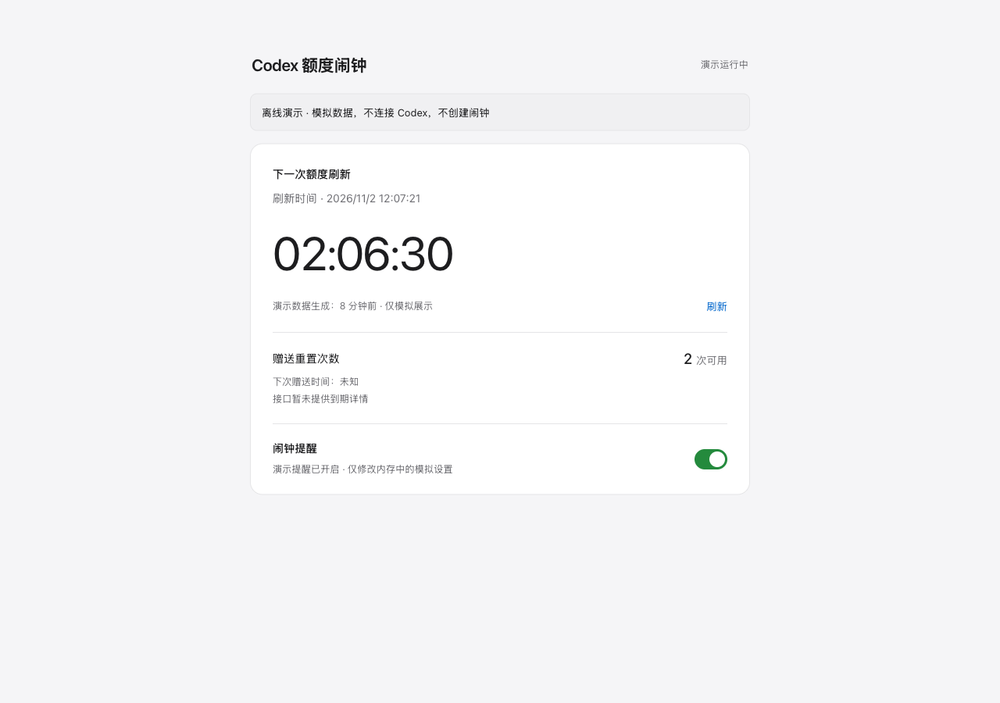

# Codex Reset Alarm

[中文](README.md) · [](https://github.com/JA0508/codex-reset-alarm/actions/workflows/tests.yml) · [MIT](LICENSE)

A local macOS alarm for the next Codex five-hour quota refresh. View the countdown, monitor health, and earned reset credits in a browser, with an optional iPhone Shortcuts bridge.



## Features

- Reads the actual reset timestamp through the signed-in Codex App Server.
- Repeats the Mac alarm until dismissed, for up to five minutes; catches missed reminders after wake.
- Pauses automatic reminders without stopping quota updates. Pausing also stops an active automatic alarm; manual sound tests remain independent.
- Detects increases in earned reset credits. It does not predict future grants or redeem credits.
- Runs the monitor, dashboard, and phone bridge as macOS login services.

## Quick start

Requires **macOS, Python 3.10+, and Codex CLI signed in with a ChatGPT account**. There are no third-party Python runtime dependencies. API-key accounts and accounts without a five-hour window may not work.

```sh
git clone https://github.com/JA0508/codex-reset-alarm.git
cd codex-reset-alarm
python3 alarm.py status
python3 launchd_setup.py install
```

Open **http://127.0.0.1:8765**. Use the dashboard sound test to check system volume and dismissal. Login services keep running after the terminal and browser close.

To remove the login services:

```sh
python3 launchd_setup.py uninstall
```

For manual operation, run `python3 alarm.py run` and `python3 dashboard.py` in separate terminals instead of installing services. Keep those terminals open. Avoid starting duplicate monitors.

**Runtime support is macOS only.** Ubuntu/Linux CI runs offline tests; it does not indicate Linux support for sounds, AppleScript, or login services. Real-device validation is on macOS; iPhone behavior still requires confirmation on the phone.

## iPhone setup and limits

Use the mobile-friendly setup page linked from the dashboard, or the [Chinese setup guide](iPhone设置.md). The phone and Mac must share a trusted Wi-Fi network. A Shortcut reads the enabled flag and reset date, removes old alarms with the dedicated label, and creates a system Clock alarm.

The Shortcut must actually run on the iPhone. Pausing reminders in the browser cannot remotely cancel an existing phone alarm: run the updated Shortcut to turn it off or remove it. Check Clock manually to confirm the result.

Clock alarms operate at minute precision; seconds are rounded up. Check the next ringing date when crossing midnight. Run the Shortcut again after a reset time or setting changes. There is no promise of unlimited iOS background synchronization or internet push. A sleeping or offline Mac cannot supply a new time.

## Security and local data

- The desktop dashboard binds to `127.0.0.1:8765`.
- The LAN bridge uses port `8766` and a random token. **Anyone holding its private URL can view quota information and change the reminder setting.** Do not share the URL, use it on public Wi-Fi, or expose the service to the internet. LAN HTTP is not encrypted.
- The app does not directly read or upload Codex login credentials and never automatically redeems reset credits.
- State, settings, tokens, and logs stay under `~/Library/Application Support/CodexResetAlarm/`. Do not commit them or attach them to public issues.

## Diagnostics and tests

```sh
python3 doctor.py
python3 doctor.py --json
python3 -m unittest discover -s tests -v
```

Doctor reads environment and service status without changing settings or querying quota. A passing check cannot prove that an iPhone alarm was created. See the [FAQ](docs/FAQ.md) for ports, `.local` resolution, proxies, permissions, and existing phone alarms.

CI runs offline tests on macOS and Ubuntu with Python 3.10 and 3.13. Report reproducible issues with redacted errors and platform versions; do not include private URLs, tokens, account details, or credentials. Pull requests with relevant tests are welcome.

## License and attribution

[MIT](LICENSE). This independent community project is not affiliated with OpenAI. Codex remains the source of truth for usable quota, and protocol changes may require updates.

Research reference: [codex-quota-watcher](https://github.com/sui-ni2/codex-quota-watcher), not a runtime dependency. See [CHANGELOG.md](CHANGELOG.md) for changes.
