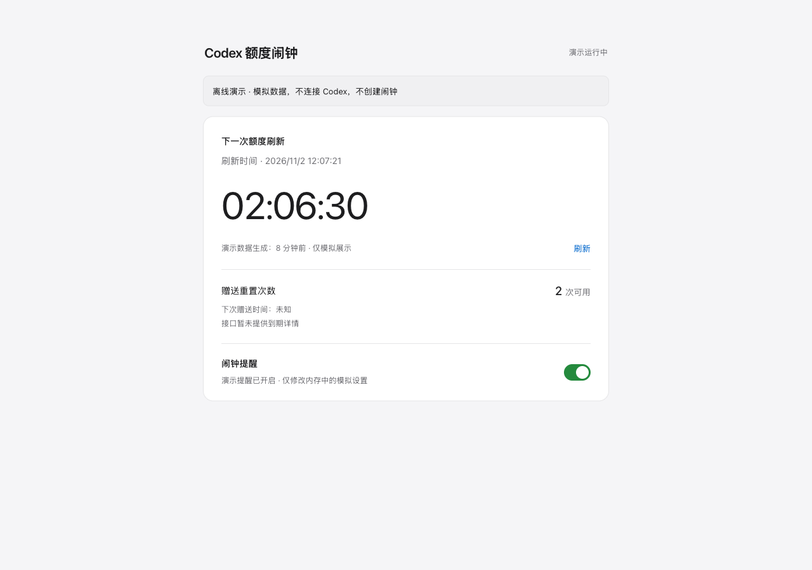

# Codex Reset Alarm

[English](README.en.md)

[](https://github.com/JA0508/codex-reset-alarm/actions/workflows/tests.yml) · [MIT License](LICENSE)

在 Mac 上跟踪 Codex 五小时额度刷新时间，到时持续响铃。用一个本地网页查看倒计时、运行状态与赠送重置次数，也可以通过 iPhone 快捷指令创建手机系统闹钟。



*界面截图使用演示数据，不包含真实账户信息。*

## 功能

- **真实刷新时间**：从已登录的 Codex 读取额度窗口，无需手动倒数五小时。
- **电脑持续响铃**：点击系统弹窗停止，最多播放五分钟；休眠后唤醒补报。
- **网页开关**：暂停或开启提醒，暂停期间继续更新额度数据。
- **赠送次数监测**：次数增加时提醒；没有可靠日期时，下次赠送显示未知。
- **登录后台运行**：监测、网页与手机桥接由 macOS 登录服务管理。
- **iPhone 系统闹钟**：手机运行快捷指令获取时间，删除旧同标签闹钟后创建新闹钟。

## 支持范围

运行环境仅支持 macOS，真实电脑端验证在 macOS 上进行。Linux/Ubuntu 仅用于离线自动测试，不代表支持 Linux 响铃、AppleScript 或登录服务。iPhone 系统闹钟仍须在手机实际运行并确认。

## 快速开始

需要 **macOS、Python 3.10+**，以及能在终端运行且已登录 ChatGPT 账号的 **Codex CLI**。无第三方 Python 运行依赖。API key 登录或未提供五小时窗口的账号可能无法使用。

```sh
git clone https://github.com/JA0508/codex-reset-alarm.git
cd codex-reset-alarm
python3 alarm.py status
```

双击 `安装登录启动.command` 安装三个后台服务，再双击 `启动网页.command` 打开控制台：

**http://127.0.0.1:8765**

点击“试听电脑闹铃”，确认系统音量和停止按钮正常。安装后无需保持终端打开，关闭网页也不会停止监测。双击 `卸载登录启动.command` 可停止并移除登录服务。

只想手动运行时，可以分别执行：

```sh
python3 alarm.py run
python3 dashboard.py
```

这两个命令需要各自保持运行；已有后台服务时无需重复启动。`查看额度.command` 提供终端状态查询。

## 提醒开关与手机

网页“闹钟提醒”开关控制自动提醒；关闭后会停止正在播放的电脑自动闹铃，并继续更新额度数据。手动点击的“试听”仍可独立播放。**网页不能远程取消 iPhone 已有的系统闹钟**：需要在手机运行一次更新后的快捷指令，才能关闭或清理旧闹钟。

按 [iPhone 设置指南](iPhone设置.md) 配置手机。电脑和手机需在同一个可信 Wi-Fi，通过带随机令牌的 `.local` 地址访问桥接服务。手机快捷指令必须实际运行，之后到“时钟 → 闹钟”确认是否创建成功；本项目不能远程确认手机执行结果。

iPhone 闹钟按时分生效，秒向上取整到下一分钟；跨日时间需自行确认。刷新时间变化后需要再次运行快捷指令。电脑休眠或离线时，手机无法获取新时间，不承诺 iOS 无限后台同步或互联网推送。

## 本地数据与安全

- 本机控制台监听 `127.0.0.1:8765`，默认不对外开放。
- iPhone 桥接使用局域网端口 `8766` 与随机访问令牌。持有专属地址的人可以查看额度信息，**也可以修改提醒开关**，请勿分享该地址或在公共 Wi-Fi 使用。局域网 HTTP 不加密，不应暴露到互联网。
- 程序通过 Codex 的本地 App Server 读取数据，不直接读取或上传登录凭据，不自动兑换赠送次数。
- 状态、设置、令牌和服务日志保存在 `~/Library/Application Support/CodexResetAlarm/`，不应提交到 GitHub。
- 监测默认每 60 秒读取一次；首次读取赠送次数仅建立基线。接口没有提供下一次赠送日期时，程序不会推测固定周期。

## 项目结构

| 文件 | 职责 |
| --- | --- |
| `alarm.py` | 额度读取、状态保存、刷新与赠送次数提醒、持续响铃 |
| `preferences.py` | 提醒开关持久化与输入校验 |
| `dashboard.py` | 本机网页服务与设置接口 |
| `iphone_bridge.py` | 手机访问桥接与闹钟时间接口 |
| `launchd_setup.py` | 安装、生成或移除 macOS 登录服务 |
| `web/index.html` | 响应式中文控制台 |
| `tests/` | 自动测试 |

## 测试与贡献

```sh
python3 -m unittest discover -s tests -v
```

欢迎通过 Issue 报告复现步骤、macOS/Python/Codex 版本与已脱敏的错误信息，或提交附带测试的 Pull Request。请勿上传令牌、完整专属 URL、账号信息或登录凭据。涉及真实声音、系统权限和 iPhone 快捷指令的改动，也请说明本机验证情况。

## 参考与声明

调研参考了 MIT 开源项目 [codex-quota-watcher](https://github.com/sui-ni2/codex-quota-watcher)，其代码未作为本项目运行依赖。

这是独立社区项目，与 OpenAI 无隶属关系。实际可用额度以 Codex 显示为准；Codex 接口变化可能需要更新本工具。

## 许可证

[MIT](LICENSE) © 2026 JA0508

## 首次配置与排错

网页中的“查看首次设置步骤”提供手机友好的分步指南，逐项解释快捷指令操作、提醒开关分支和闹钟去重；完整文字版见 [iPhone 设置指南](iPhone设置.md)。配置后请在手机时钟中手动确认。

遇到端口占用、`.local` 解析、代理、权限确认或暂停后手机仍响铃，可先阅读 [常见问题](docs/FAQ.md)。使用项目提供的 `doctor` 自检入口检查本机环境和服务状态；自检通过也不能证明 iPhone 已执行快捷指令。

### 一键自检

双击 `一键检查.command`，或运行：

```sh
python3 doctor.py
python3 doctor.py --json
```

检查只读取环境和服务状态，不修改提醒开关、不请求额度、不输出专属访问令牌。端口连通不等同于手机闹钟已创建。

版本变更见 [CHANGELOG.md](CHANGELOG.md)。安装前会检查系统、Python、脚本和 Codex 可执行文件；登录状态仍需通过 `python3 alarm.py status` 确认。

### 从网页复制手机连接地址

在电脑控制台展开“iPhone 系统闹钟”，点击“查看手机连接地址”，即可复制手机网页地址和快捷指令数据地址；主机名解析失败时可使用可用的 IP 回退地址。无需打开终端查看链接。自动复制失败时，页面会选中地址供手动复制。手机和电脑仍需连接同一个可信 Wi-Fi。

这些专属地址包含访问令牌，持有者可以查看额度并修改提醒开关，请勿分享或上传。地址只在用户点击后读取，手机页面隐藏此入口。
